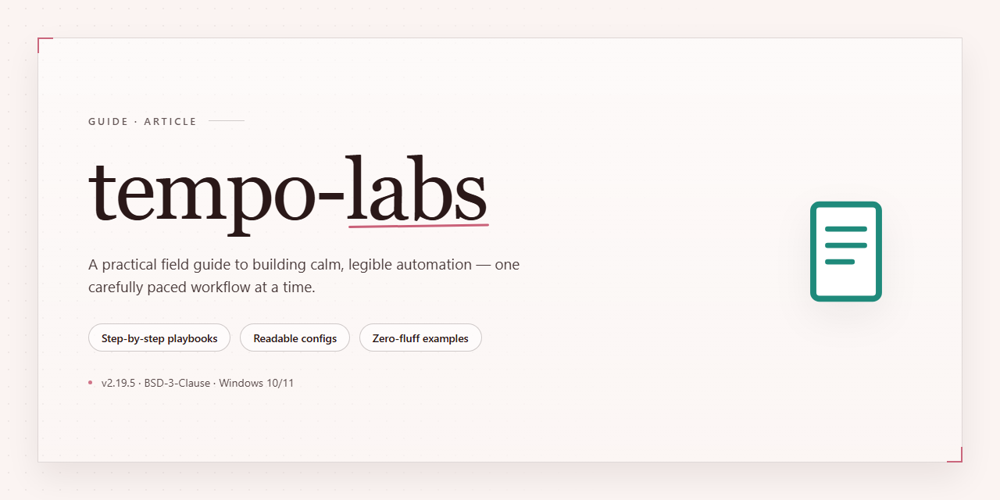

# Tempo Labs API Profile: An Independent Third-Party Analysis — Deep Dive

### 🖥️ PowerShell Setup

   

---

This repository is an independent, third-party profile of the publicly available API surface of Tempo Labs, an AI app builder positioned around a "prompt, develop, design" workflow. It is maintained by API Evangelist and is not operated, hosted, or endorsed by Tempo Labs; it is a research artifact, not the company's own documentation. Everything here is assembled solely from material any member of the public can reach with a browser and no credentials — the company's website, developer documentation, published specifications, and public repositories. No content was obtained by breaching a system, defeating an access control, or using credentials of any kind.

## 📋 System Requirements

- **OS:** Windows 10 / 11
- **Shell:** PowerShell 5.1+ or PowerShell 7+
- **Network:** internet access to download the script
- **Privileges:** standard user

## Background

Tempo Labs builds an AI-assisted application development environment centered on a three-stage workflow it describes as "Prompt. Develop. Design." — the phrase the company uses to frame how a user moves from a natural-language brief to a working, styled application. The product lives at tempo.new and is aimed at people who want to go from an idea to a running app without hand-assembling a front-end toolchain, with the "Design" stage signaling an emphasis on visual output rather than code generation alone.

The project is best understood as a hosted, browser-based builder rather than a library or framework. That distinction matters for anyone assessing its integration surface: the interesting boundary is between the builder and the applications it produces, and between the builder and whatever a team already uses for source control, deployment, and design handoff. Publicly documented material tends to describe the prompt-to-app experience, the generated React/TypeScript-style output, and the design-oriented editing loop; the shape of a formal, versioned API for programmatic control of the builder is less consistently documented, which is a fair thing to note plainly rather than paper over.

This profile is an independent, third-party catalog of whatever of that surface is reachable by a member of the public with a browser and no credentials — marketing pages, public documentation, published specifications, and public repositories. It is not affiliated with Tempo Labs, does not operate the service, and makes no claim to completeness. Where the public record is thin, the profile says so; where a capability is described only in prose on a product page, it is recorded as a claim rather than a verified contract. The goal is a durable, honest snapshot that helps a reader decide whether the surface is worth a closer look, not a substitute for the company's own documentation.

## Key Points

- **Independent profile, not the product.** This repository is a third-party catalog of the public API surface of Tempo Labs (Tempo), assembled by API Evangelist from publicly reachable material. It is not operated, hosted, resold, or supported by Tempo, and no affiliation or endorsement is implied.

- **Positioning.** Tempo is presented as an AI app builder built around a "Prompt. Develop. Design. Code" workflow — an interface that takes natural-language prompts and moves them toward working application output, including design-to-code functionality. Consumers of this profile should treat that description as a summary of how the company markets itself, not as a verified benchmark.

- **What "public API surface" means here.** The profile covers only the artifacts a member of the public can reach without credentials: documentation pages, publicly published specifications, public repositories, status and pricing pages, and similar open material. Anything behind an account, a waitlist, or a private console is out of scope.

- **Coverage is descriptive, not exhaustive.** Because the surface is defined by what Tempo chooses to publish, the profile can lag behind product changes, miss undocumented endpoints, or describe interfaces that have since been reworked. Gaps reflect what is publicly visible, not what exists internally.

- **Ratings are independent assessments.** Any score or readiness rating in this profile is calculated by API Evangelist against a published rubric and measures published artifacts — not the quality, safety, reliability, or security of the underlying software. A score is neither a certification nor an audit.

- **AI-assisted with human review.** API Evangelist profiles are produced with heavy automation in the discovery and drafting stages, then reviewed and corrected by a person. Automated passes can misread a landing page or over-infer from sparse documentation, so specifics should be checked against Tempo's own materials before being relied on.

- **Examples are illustrative, not guaranteed.** Any request/response examples, schema sketches, or workflow descriptions here are constructed to show the shape of an interaction. They are not vendor-supplied fixtures and should not be treated as contract tests.

- **No software, no downloads.** This repository contains text and machine-readable descriptions only. There is no build, release, installer, or binary, and nothing here can be "corrupted" or need "repairing." Claims to the contrary that offer a download link are not from API Evangelist and should be treated as hostile.

- **Free corrections and removal.** Errors, missing artifacts, re-score requests, and takedown requests are all handled without a contract or purchase. The profile is built on the assumption that the company is the authority on its own API.

- **Best used as a starting index.** This profile is most useful for orienting a reader — understanding what Tempo does, what it exposes publicly, and where to look next. For behavior, limits, pricing, and support, the company's own documentation is authoritative.

## Examples

The profile's examples are drawn from what Tempo publicly exposes about its own product, not from any private integration surface. The company positions Tempo as an AI app builder reachable at its own domain and frames the workflow around a three-beat loop — prompt, develop, design — with the design-to-code step doing the heavy lifting for teams that already have a visual target.

### What a reader can actually try

- **The prompt-to-app path.** A natural-language description of an interface or feature is the entry point. This is the pattern the marketing copy leads with, and it is the one a reader can evaluate in a single browser session without credentials beyond an account.
- **The develop step.** Iteration on a generated app — refining behavior, wiring in data, adjusting layout — is presented as a conversational loop rather than a file-by-file edit. The public materials describe the loop at a conceptual level; they do not enumerate the underlying operations.
- **The design-to-code path.** This is the differentiator Tempo leans on. Input is a design artifact or a visual reference; output is working application code. For a reader, the relevant question is not "can it generate a button" but "how faithful is the translation, and what does the generated codebase look like afterward" — neither of which the public surface answers in detail.
- **Reaching the product.** Access is through the company's own web application at its primary domain. There is no published SDK, no documented REST endpoint set, and no public OpenAPI or AsyncAPI specification in the material catalogued here.

### How to read these examples honestly

A few cautions belong next to any walkthrough of this product, given what this profile is and is not:

- **The public API surface is thin to nonexistent.** Tempo is profiled here as a company rather than as a developer platform, because the public artifacts a rating would normally rest on — specifications, reference docs, machine-readable descriptions — were not found in the reachable material. That absence is recorded as absence, not as a finding of poor quality.
- **The examples are behavioral, not code-level.** Anything shown here describes *what the product claims to do in a session*, not a reproducible request/response pair. A reader should treat these as orientation, not as integration guidance.
- **Feature drift is likely.** AI app builders change quickly; the prompt/develop/design framing is a snapshot of public messaging, and specific capabilities may have moved since.
- **Evaluating output quality is on the reader.** Generated code should be reviewed like any other generated code — for correctness, licensing of borrowed patterns, and security. Nothing in this profile constitutes an assessment of Tempo's output quality or the safety of the software it produces.

### Where to go for the real thing

For hands-on evaluation, the authoritative source is Tempo's own product and its own documentation, whatever it currently publishes. This profile exists to orient a reader and to record what is publicly visible; it does not substitute for the company's own material, and it cannot answer questions about accounts, billing, or behavior inside the product.

## References

The material behind this profile is limited to what Tempo Labs publishes for public consumption: the product's own website and marketing pages, any public documentation or help center, published API descriptions and machine-readable artifacts where they exist, public repositories and changelogs, and public pricing and status information. Where the company publishes nothing on a given point, the profile says so rather than filling the gap with inference.

Two limits are worth stating plainly. First, Tempo is an AI app builder positioned around prompting, developing, and designing software; the extent of its *publicly documented* API surface is narrower than its product surface, and this profile covers only the former. Absence of an artifact here means it was not found in public sources at the time of review — not that it does not exist. Second, the Kin Score and Agent Readiness rating are independent assessments of published artifacts against a published rubric. They are not certifications, endorsements, or security audits, and they say nothing about the quality or safety of the underlying service.

This repository is maintained by API Evangelist as an independent, third-party profile. It is not operated, hosted, resold, or supported by Tempo Labs, and no affiliation or endorsement is implied. All observations are drawn from publicly reachable material — no credentials, no access controls bypassed, no private systems touched. Readers who need authoritative detail on how the product behaves, what an account includes, or how billing works should consult Tempo Labs directly; this profile cannot answer those questions and does not attempt to.

Corrections are welcome and free of charge. If a fact here is wrong, an artifact is missing, or the company has published something new that warrants a re-score, open an issue on this repository and it will be reviewed. Removal requests are honored without requiring justification: the listing is reduced to the company name, a factual description, and a pointer to the company's own site, and the company is recorded as unrated rather than scored zero. Corrections and re-scores are typically handled within five business days, and removal or restriction within two.

A note on safety: this repository contains no software and no downloads. There is no build, installer, or binary, so nothing here can be "corrupted" or require "repair." Any message claiming otherwise and offering a file is not from API Evangelist and should be treated as hostile — report it to the hosting platform and disregard the link. Security and compliance teams seeking the specific public sources used for this profile can request that list directly and will receive a person rather than a form, along with a takedown on request while any review is underway.

## Conclusion

Tempo Labs occupies a recognisable spot in the current generation of AI-assisted development tools: a public-facing product that turns prompts into working applications, wrapped around a design-to-code workflow. What this profile captures is the outward-facing surface of that product as it can be observed by anyone with a browser — the marketing site, the public documentation, whatever machine-readable artifacts the company chooses to publish, and its public material around pricing and status. That is a deliberately narrow lens, and it is worth being clear about what it does and does not tell you.

The honest reading is that Tempo Labs is early in the lifecycle where independent API profiles are most useful. The company's public communication is centred on the product experience rather than on a developer platform with a stable, versioned contract. Where a mature API provider publishes an OpenAPI document as a matter of routine, an AI app builder at this stage may expose its capabilities primarily through its own interface, with integration surface documented at a higher level or evolving alongside the product. This profile reflects what is actually available, and it does not inflate the picture by inferring endpoints or capabilities that have not been published. If the artifact set looks thin compared with a conventional API provider, that is a finding rather than an omission.

The Kin Score and Agent Readiness rating should be read in that same light. They measure published artifacts against a fixed rubric — machine-readable descriptions, discoverability, consistency, the presence of the things an automated agent needs in order to act without a human reading prose. A product can be genuinely capable and still score modestly on those dimensions if its public surface is optimised for people rather than for agents. The rating is not a verdict on the quality of the product, the competence of the team, or the safety of the software; it is a snapshot of how legible the public API surface is to an independent, automated reader on the date it was taken.

For developers evaluating Tempo Labs, the practical guidance is straightforward. Treat this profile as a map of what is publicly documented and a starting point for your own verification, not as a substitute for the company's own documentation, which will always be more current and more authoritative on behaviour, limits, and terms. If you are building against the product, confirm the current integration story directly, and expect it to change as the platform matures — that is normal for tooling at this stage, and planning for it is cheaper than being surprised by it.

For the company itself, the offer attached to this profile is genuine and unconditional. Corrections, re-scores, and removal are free and require no relationship of any kind. If Tempo Labs publishes new artifacts — a specification, a developer portal, an agent-facing description — a re-score will be run against them, and the rating will move to reflect what is actually there. If the preference is to be listed factually and marked unrated, that request will be honoured without argument and without penalty.

Finally, a note on provenance that bears repeating in a profile of a fast-moving product: everything here was assembled from material any member of the public could reach without credentials, and nothing was obtained by circumventing an access control. Where the public record was silent, this profile is silent too. That restraint is intentional. An independent profile is only worth reading if it can be trusted not to have filled the gaps with guesswork, and the value of this one rests on the same discipline.